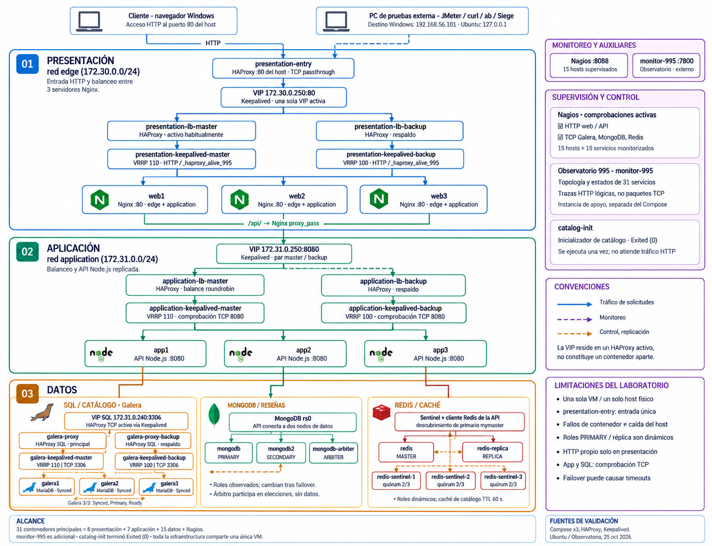
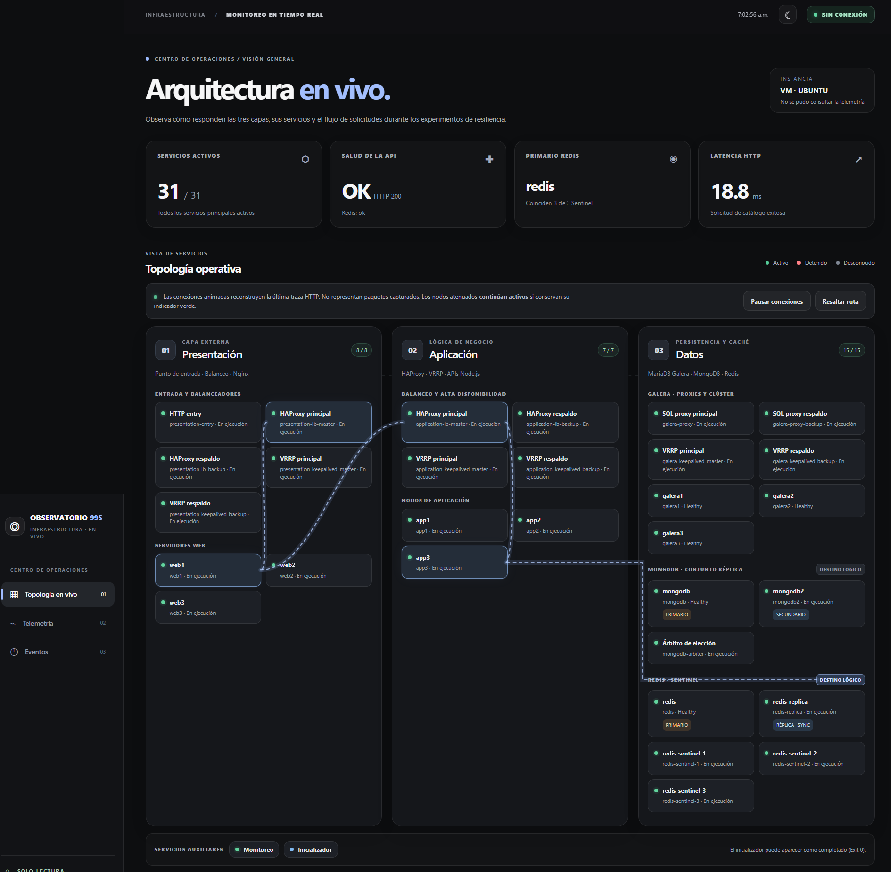

# Tarea #995 — Sistema distribuido de tres capas

**Alta disponibilidad, balanceo de carga, replicación y pruebas de resiliencia.**

Este proyecto académico de **Sistemas Distribuidos**, desarrollado a partir de [tuxtter/distributedsystems](https://github.com/tuxtter/distributedsystems), implementa una aplicación web de **catálogo de productos y reseñas** mediante una arquitectura de tres capas: presentación, aplicación y datos. El objetivo es comprobar cómo se comporta el sistema ante solicitudes concurrentes, pérdida de servicios y recuperación de componentes, utilizando balanceadores, réplicas y mecanismos de conmutación por fallos.

> **Documentación principal:** [Wiki de la Tarea #995](https://github.com/Davidisai28/sistemas-distribuidos-Tarea-995/wiki). Este README resume la implementación; los procedimientos, configuraciones, experimentos y evidencias detalladas se desarrollan en la Wiki.

## Arquitectura del sistema

El tráfico HTTP entra por `presentation-entry` y se dirige a la VIP de presentación. Desde uno de los tres servidores Nginx, las solicitudes de API pasan a la VIP de aplicación y a una de las tres instancias Node.js. La capa de datos integra **MariaDB Galera** para el catálogo, **MongoDB Replica Set** para reseñas y **Redis con Sentinel** para caché y recuperación del primario.

```mermaid
flowchart TB

    %% CLIENTES Y AUXILIARES
    browser["Cliente<br/>Navegador Windows"]
    load["Equipo de pruebas<br/>JMeter / curl / ab / Siege"]

    subgraph AUX["Monitoreo y herramientas auxiliares"]
        direction TB
        nagios["Nagios<br/>:8088<br/>15 hosts / 15 servicios"]
        observ["monitor-995<br/>:7800<br/>Observatorio 995"]
        cataloginit["catalog-init<br/>Inicializador<br/>Exited (0)"]
    end

    %% CAPA 1 - PRESENTACION
    subgraph P["01 PRESENTACIÓN · red edge"]
        direction TB

        entry["presentation-entry<br/>HAProxy TCP · puerto 80 del host<br/>Punto de entrada"]
        pvip["VIP presentación<br/>172.30.0.250:80"]

        subgraph PHA["Alta disponibilidad de presentación"]
            direction LR

            subgraph PM["Par master"]
                direction TB
                pkm["presentation-keepalived-master"]
                plbm["presentation-lb-master<br/>HAProxy HTTP"]
                pkm -. "Comprobación HTTP" .-> plbm
            end

            subgraph PB["Par backup"]
                direction TB
                pkb["presentation-keepalived-backup"]
                plbb["presentation-lb-backup<br/>HAProxy HTTP"]
                pkb -. "Comprobación HTTP" .-> plbb
            end
        end

        web1["web1<br/>Nginx"]
        web2["web2<br/>Nginx"]
        web3["web3<br/>Nginx"]
    end

    %% CAPA 2 - APLICACION
    subgraph A["02 APLICACIÓN · red application"]
        direction TB

        avip["VIP aplicación<br/>172.31.0.250:8080"]

        subgraph AHA["Alta disponibilidad de aplicación"]
            direction LR

            subgraph AM["Par master"]
                direction TB
                akm["application-keepalived-master"]
                albm["application-lb-master<br/>HAProxy HTTP"]
                akm -. "Comprobación TCP" .-> albm
            end

            subgraph AB["Par backup"]
                direction TB
                akb["application-keepalived-backup"]
                albb["application-lb-backup<br/>HAProxy HTTP"]
                akb -. "Comprobación TCP" .-> albb
            end
        end

        app1["app1<br/>API Node.js :8080"]
        app2["app2<br/>API Node.js :8080"]
        app3["app3<br/>API Node.js :8080"]
    end

    %% CAPA 3 - DATOS
    subgraph D["03 DATOS · redes application / database / redis-ha"]
        direction LR

        subgraph SQL["SQL / Catálogo"]
            direction TB

            sqlvip["VIP SQL / Galera<br/>172.31.0.240:3306"]

            subgraph SQLHA["Alta disponibilidad SQL"]
                direction LR

                subgraph GM["Par master"]
                    direction TB
                    gkm["galera-keepalived-master"]
                    gp1["galera-proxy<br/>HAProxy SQL"]
                    gkm -. "Comprobación TCP" .-> gp1
                end

                subgraph GB["Par backup"]
                    direction TB
                    gkb["galera-keepalived-backup"]
                    gp2["galera-proxy-backup<br/>HAProxy SQL"]
                    gkb -. "Comprobación TCP" .-> gp2
                end
            end

            g1[("galera1<br/>MariaDB Galera")]
            g2[("galera2<br/>MariaDB Galera")]
            g3[("galera3<br/>MariaDB Galera")]

            gkm -. "Gestiona VIP" .-> sqlvip
            gkb -. "VRRP respaldo" .-> sqlvip

            sqlvip -->|"Activo habitual"| gp1
            sqlvip -. "Failover" .-> gp2

            gp1 --> g1
            gp1 --> g2
            gp1 --> g3

            gp2 -. "Respaldo" .-> g1
            gp2 -. "Respaldo" .-> g2
            gp2 -. "Respaldo" .-> g3

            g1 <--> g2
            g2 <--> g3
            g3 <--> g1
        end

        subgraph MONGO["MongoDB / Reseñas"]
            direction TB

            rs0["Replica Set rs0<br/>Roles dinámicos"]

            m1[("mongodb<br/>PRIMARY observado")]
            m2[("mongodb2<br/>SECONDARY observado")]
            m3["mongodb-arbiter<br/>ARBITER · sin copia de datos"]

            rs0 -. "Miembro de datos" .-> m1
            rs0 -. "Miembro de datos" .-> m2
            rs0 -. "Miembro árbitro" .-> m3

            m1 -. "Replicación observada" .-> m2
            m3 -. "Voto en elecciones" .-> rs0
        end

        subgraph REDIS["Redis / Caché"]
            direction TB

            rha["Redis HA + Sentinel<br/>Agrupación lógica"]

            r1[("redis<br/>MASTER observado")]
            r2[("redis-replica<br/>REPLICA observada")]

            s1["redis-sentinel-1"]
            s2["redis-sentinel-2"]
            s3["redis-sentinel-3"]

            rha -.-> r1
            rha -.-> r2
            rha -.-> s1
            rha -.-> s2
            rha -.-> s3

            r1 -. "Replicación observada" .-> r2

            s1 -. "Supervisión" .-> r1
            s2 -. "Supervisión" .-> r1
            s3 -. "Supervisión" .-> r1
        end
    end

    %% FLUJO PRINCIPAL
    browser -->|"HTTP :80"| entry
    load -->|"HTTP :80"| entry

    entry --> pvip

    pkm -. "Gestiona VIP" .-> pvip
    pkb -. "VRRP respaldo" .-> pvip

    pvip -->|"Activo habitual"| plbm
    pvip -. "Failover" .-> plbb

    plbm --> web1
    plbm --> web2
    plbm --> web3

    plbb -. "Respaldo" .-> web1
    plbb -. "Respaldo" .-> web2
    plbb -. "Respaldo" .-> web3

    web1 -->|"/api/ vía VIP"| avip
    web2 -->|"/api/ vía VIP"| avip
    web3 -->|"/api/ vía VIP"| avip

    akm -. "Gestiona VIP" .-> avip
    akb -. "VRRP respaldo" .-> avip

    avip -->|"Activo habitual"| albm
    avip -. "Failover" .-> albb

    albm --> app1
    albm --> app2
    albm --> app3

    albb -. "Respaldo" .-> app1
    albb -. "Respaldo" .-> app2
    albb -. "Respaldo" .-> app3

    %% APP -> DATOS
    app1 -->|"Catálogo SQL"| sqlvip
    app2 -->|"Catálogo SQL"| sqlvip
    app3 -->|"Catálogo SQL"| sqlvip

    app1 -->|"Reseñas"| rs0
    app2 -->|"Reseñas"| rs0
    app3 -->|"Reseñas"| rs0

    app1 -->|"Caché / Sentinel"| rha
    app2 -->|"Caché / Sentinel"| rha
    app3 -->|"Caché / Sentinel"| rha

    %% MONITOREO / AUXILIARES
    nagios -. "Sondeos HTTP / TCP" .-> P
    nagios -. "Sondeos HTTP / TCP" .-> A
    nagios -. "Sondeos HTTP / TCP" .-> D

    observ -. "Estados / topología" .-> P
    observ -. "Estados / trazas" .-> A
    observ -. "Estados / topología" .-> D

    cataloginit -. "Inicializa catálogo" .-> sqlvip
    cataloginit -. "Prepara reseñas" .-> rs0
```

<a href="docs/arquitectura-tarea995.png"></a>

<sub>Diagrama general de los servicios y sus relaciones. Haz clic para ampliar la imagen.</sub>

<details>
<summary><strong>Ver arquitectura Mermaid completa (servicios, enlaces y VIP)</strong></summary>



</details>

El código también está disponible en [`docs/arquitectura-completa.mmd`](docs/arquitectura-completa.mmd).

### Componentes principales

| Capa o servicio | Implementación | Función |
|---|---|---|
| **Presentación** | `presentation-entry`, HAProxy principal/respaldo, Keepalived y `web1`–`web3` (Nginx) | Entrada HTTP, balanceo y VIP `172.30.0.250:80`. |
| **Aplicación** | HAProxy principal/respaldo, Keepalived y `app1`–`app3` (Node.js) | Distribución de peticiones y API mediante la VIP `172.31.0.250:8080`. |
| **Catálogo SQL** | MariaDB Galera (3 nodos), HAProxy SQL y Keepalived | Replicación y acceso por la VIP `172.31.0.240:3306`. |
| **Reseñas** | MongoDB Replica Set `rs0`: dos nodos de datos y un árbitro | Persistencia y elección de primario. |
| **Caché** | Redis principal/réplica y tres Sentinel (quórum 2) | Almacenamiento temporal y recuperación del servicio de caché. |
| **Observabilidad** | Nagios, Observatorio 995 y DockGraph | Estado de servicios, verificaciones HTTP/TCP y topología operativa. |

Las VIP están gestionadas por Keepalived y se ubican en la instancia HAProxy activa; **no representan contenedores independientes**. El balanceador SQL reparte conexiones TCP hacia nodos Galera saludables, no consultas SQL individuales. La infraestructura comparte un único anfitrión, por lo que las pruebas verifican resiliencia de servicios y contenedores, no tolerancia a una caída física del anfitrión.

## Funcionamiento de la aplicación

El catálogo obtiene de MariaDB los productos de menor precio y puede almacenar temporalmente la respuesta en Redis. Si no existe una entrada válida en caché, la API consulta SQL y vuelve a poblarla. Las reseñas se consultan y registran en MongoDB. La interfaz incluye opciones para explorar la API, invalidar la caché y consultar una traza lógica de cada solicitud mediante `X-Request-Trace`.

| Ruta | Operación |
|---|---|
| `GET /api/health` | Verificar el estado de la API. |
| `GET /api/products/cheapest` | Consultar los productos de menor precio. |
| `GET /api/products/ST-001/reviews` | Consultar las reseñas de un producto. |
| `POST /api/products/ST-001/reviews` | Registrar una reseña. |
| `POST /api/cache/clear` | Invalidar la caché del catálogo. |

## Observatorio 995

El **Observatorio 995** (`monitor-995`, puerto `7800`) muestra las tres capas, la distribución de servicios y el recorrido lógico de las solicitudes, lo que facilita el seguimiento durante los experimentos de resiliencia. Se complementa con las comprobaciones de disponibilidad de Nagios.

<a href="docs/observatorio-995.png"></a>

<sub>Captura de la interfaz del Observatorio. Las conexiones animadas representan trazas lógicas, no paquetes de red capturados. El indicador «Sin conexión» visible en la captura no demuestra telemetría activa en ese instante.</sub>

## Configuración y ejecución

El despliegue completo combina [`docker-compose.yml`](docker-compose.yml), [`docker-compose.override.yml`](docker-compose.override.yml) y [`docker-compose.redis-ha.yml`](docker-compose.redis-ha.yml). La configuración privada se prepara con [`.env.example`](.env.example); MongoDB requiere además su clave de autenticación de réplica y el proxy SQL una imagen local específica.

Para comprobar la definición combinada:

```bash
docker compose -f docker-compose.yml -f docker-compose.override.yml -f docker-compose.redis-ha.yml config --quiet
```

El procedimiento de inicialización, arranque y recuperación de los clústeres está documentado en la [Wiki](https://github.com/Davidisai28/sistemas-distribuidos-Tarea-995/wiki). No se deben publicar `.env`, contraseñas o claves privadas ni eliminar volúmenes para repetir una prueba.

## Pruebas y resultados

Se realizaron pruebas funcionales, de rendimiento, alta disponibilidad, caos y monitoreo. Estos resultados corresponden a ejecuciones registradas y **no representan una garantía de disponibilidad absoluta**.

| Prueba | Resultado observado |
|---|---|
| **JMeter Smoke / Load** | 100/100 muestras exitosas (p95: 11 ms) y 2,965/2,965 en 600 s (p95: 12 ms). |
| **Stress y Spike** | 5,250/5,250 respuestas correctas en ApacheBench y 18,881/18,881 en Spike 5 → 300 → 5. |
| **Soak** | Dos corridas de ~30 min, con 8,511 y 8,512 operaciones correctas; se solaparon temporalmente. |
| **Efecto de Redis** | 60/60 operaciones evaluadas; media MISS de 24.15 ms frente a HIT de 17.00 ms. |
| **VIP presentación y aplicación** | 205/205 y 206/206 respuestas HTTP 200 en pruebas de conmutación. |
| **Galera y Redis** | Galera: 393/393 operaciones correctas. Redis: 438/438 GET 200; una invalidación de caché falló. |
| **VIP SQL y MongoDB** | VIP SQL: 165/169 HTTP 200 (4 respuestas 503). MongoDB: 478/488 HTTP 200 (8 respuestas 503 y 2 timeouts). |
| **HAProxy, Pumba y Nagios** | Retest HAProxy: 249/251 HTTP 200; Pumba `netem`: 247/247; Nagios detectó `CRITICAL/HARD` y recuperación `OK/HARD` de `web3`. |

Las pruebas identificaron recuperación efectiva de componentes y también **errores transitorios durante determinadas conmutaciones**. Los resultados completos, tiempos, condiciones y diagnósticos se describen en la Wiki.

## Evidencias y documentación

Los registros y capturas seleccionados se organizan como archivos individuales en [`evidencias/`](evidencias/): [imágenes para la Wiki](evidencias/wiki/imagenes/), [JMeter](evidencias/jmeter/), [rendimiento](evidencias/rendimiento/), [failover](evidencias/failover/), [caos](evidencias/caos/), [observabilidad](evidencias/observabilidad/) y [diagnósticos](evidencias/diagnostico/).

La **[Wiki del proyecto](https://github.com/Davidisai28/sistemas-distribuidos-Tarea-995/wiki)** contiene la documentación técnica completa: descripción y objetivos, arquitectura, tecnologías, instalación, pruebas, alta disponibilidad, monitoreo, problemas resueltos y conclusiones.

---

<sub>Proyecto académico de Sistemas Distribuidos · Tarea #995 · Octubre de 2026.</sub>